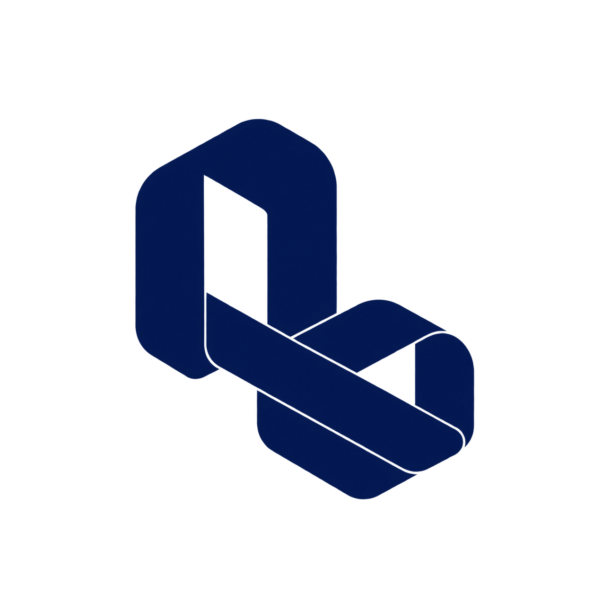

#  Lace

**A lightweight, self-hosted headless CMS for Astro websites.**

Lace keeps your content model and website in code while giving editors a focused
admin interface for everyday publishing. One installation manages one website.

- Define pages, collections, shared globals and reusable blocks with TypeScript.
- Write rich text, organize nested fields and reuse media in a browser.
- Keep drafts separate from published content, with administrator-controlled publication.
- Build a static Astro site through the SDK and customize block components you own.
- Run on your own VPS with Node, SQLite and SILO, or on Cloudflare Workers, D1 and R2.

The current release candidate is **1.0.0**, with an in-place upgrade from
**0.1.0-rc5**. Check the [published releases](https://github.com/lacecms/lace/releases)
for downloadable artifacts. Latest documentation follows `main`.

**[Read the documentation](https://lacecms.github.io/lace/en/latest/)** for setup,
content modeling, editing, Astro integration and deployment.

Working on the CMS itself? Read **[Developing Lace](DEVELOPMENT.md)** for the
engine checkout, local stack, tests and contributor workflow. The repository's
[`docs/` index](docs/README.md) lists internal engineering documentation and its status.
