# Data model

Part of the [Lace architecture](README.md).

## 9. Content data model

The Drizzle schema in `packages/db/src/schema/*.ts` and the checked-in
migrations define every table, column and index; this section states what they
must guarantee
([sqlite-schema-and-migrations](../../openspec/specs/sqlite-schema-and-migrations/spec.md)).
Primary IDs are application-generated sortable string IDs such as ULIDs.
Timestamps are UTC Unix milliseconds in the database and ISO 8601 strings in
REST responses. Binary media never live in the database. Every model shares
the content tables ([ADR 0026](../adr/0026-code-defined-models-two-snapshots.md)); a block type never receives a dedicated table or
columns.

### 9.1 Content models

`content_models` holds each configured model's `key`, `kind` (`page`,
`collection` or `global`), label, configuration version and sync hashes.

- `key` is a stable programmatic identifier. Labels may change freely; renaming
  a key is a migration, not a display-name edit.
- `structure_json` is the canonical structure as of the last successful sync,
  valid only while `structure_json_hash` equals `structure_hash`. It is sync
  metadata, never an authoritative copy of the configuration.
- `public_projection_hash` records the public-projection identity and
  `public_projection_source_hash` the full `projection_hash` it was computed
  for. A mismatched source invalidates the public baseline, including after an
  older binary changes the full projection during a rollback. Sync writes both
  in its guarded final mutation
  ([collection-query-options](../../openspec/specs/collection-query-options/spec.md)).

### 9.2 Content entries

`content_entries` holds each entry's `model_key`, `singleton_key`, draft and
published snapshot pointers, creator and timestamps.

- `draft_snapshot_id` is nullable in SQL only to break the insertion cycle with
  the first snapshot. Entry creation inserts the entry and its draft snapshot
  and assigns the pointer atomically; a committed entry without a draft is
  invalid. `published_snapshot_id` stays `NULL` until the first publication.
- The API sets `singleton_key = 1` for pages and globals and `NULL` for
  collection entries. Because SQLite allows many `NULL`s in a unique index, the
  partial unique index `content_entries_singleton_idx` on `model_key`
  `WHERE singleton_key = 1` enforces one entry per page or global model. The
  application still validates cardinality; the index is the final guarantee.

### 9.3 Content snapshots

`content_snapshots` holds an entry's draft and published versions. System
fields used for identity, routing, concurrency or common queries (`revision`,
`slug`, `title`, `updated_by`) are relational columns.

- `fields_json` holds model fields, including composite objects and lists, as
  plain JSON without item envelopes or value tables
  ([ADR 0013](../adr/0013-bounded-composite-fields.md)).
- `seo_json` holds the normalized SEO group (§8), or `NULL`; an all-empty group
  is never stored. Save, publication, revert and duplication copy it
  ([ADR 0011](../adr/0011-seo-system-group.md)).
- A published snapshot holds the published projection of conditional fields
  (§8): fields, block data and media and internal-link references omit hidden
  targets, while the draft keeps them
  ([conditional-fields](../../openspec/specs/conditional-fields/spec.md)).

The draft is mutable. Editors cannot change a published snapshot: only the
publish use case replaces it and only the unpublish use case removes it (§10).
Configuration synchronization may rewrite its stored fields and blocks for a
classified schema change (§8), advancing the published version atomically for
field rewrites and after resumable block migrations (§4.7,
[ADR 0007](../adr/0007-schema-evolution-during-sync.md)). Reverting a draft
sets the published snapshot's `revision` to the new draft revision without
changing its content, so a draft equal to its publication is derived as
published ([ADR 0008](../adr/0008-entry-lifecycle-commands.md)).

Holding both snapshots duplicates text intentionally; it fits the D1 free-plan
limit because binaries are excluded, and pages are split into block rows.

### 9.4 Content blocks

`content_blocks` holds a snapshot's blocks, keyed by `(snapshot_id, block_key)`
and indexed by `(snapshot_id, position)`.

- `block_key` is stable across draft and published copies, so a snapshot is
  copied with one `INSERT ... SELECT` without new per-row IDs.
- The block envelope ([ADR 0012](../adr/0012-block-envelope.md)) stores
  presentation values outside the data: optional `anchor` and `class_name`, a
  `hidden` flag and the declared `settings_json` (§11) with defaults applied.
  Every block copy (publish, revert, duplicate) and write (save, sync
  migration) carries these columns on both runtimes; a block without them
  reads as visible, without anchor or class, with `{}` settings
  ([content-domain-rules](../../openspec/specs/content-domain-rules/spec.md)).
- Block data, including bounded groups and lists, stays JSON validated by the
  block registry. Composite data does not expand the settings allowlist.

### 9.5 Block ordering and nesting

- Blocks form one flat top-level list ([ADR 0026](../adr/0026-code-defined-models-two-snapshots.md)). A block may hold bounded
  nested data in `data_json`; parent/child block trees are out of scope.
- Positions are sparse integers (`1000`, `2000`, ...). An insertion normally
  changes only the inserted block; positions are normalized when no safe gap
  remains ([content-domain-rules](../../openspec/specs/content-domain-rules/spec.md)).
- An anchor is unique within an entry, hidden blocks included: validation
  rejects a repeat (`duplicate_block_anchor`) and a partial unique index on
  `(snapshot_id, anchor)` enforces it, so draft and published copies share
  anchors. Saves delete and reinsert draft block rows, so swaps never collide.

All draft mutations are atomic at snapshot scope: a successful mutation
replaces the fields and the complete ordered block list, increments
`revision` exactly once and updates `updated_at` and `updated_by`. Block rows
never change while the revision does not; optimistic concurrency and the D1
publication batch depend on this
([ADR 0002](../adr/0002-d1-batches-and-node-transactions.md)).

### 9.6 Published routes

`published_routes` maps each public `path` (primary key) to its entry and
published snapshot, guaranteeing unique paths and direct lookup by URL. A page
path is fixed by its model; a collection path comes from the model route and
the published slug, so a draft slug change does not move it. Globals never own
a route: their publication writes no row, so by-path reads, collection lists
and the export's `entries` never contain them; they are read by model key
(§12, [ADR 0010](../adr/0010-global-models.md)).

### 9.7 Media

`media` holds one metadata row per stored object: a unique opaque
`storage_key`, binary-derived MIME type, displayed `width` and `height` (after
EXIF orientation, recorded by every upload), descriptive metadata, `status`
(`active`, `deleting`, `delete_failed`) and a reserved `metadata_json` that is
always `'{}'`. Content stores `mediaId` references; storage URLs may be derived
or signed and are never database identity
([media-use-cases](../../openspec/specs/media-use-cases/spec.md)).

- Tags live in `media_tags (media_id, tag)`, cascading with the media row. They
  are admin-only (never in public content, the build export or MCP) and never
  count as usage. Create, tag replacement and final deletion persist them
  atomically with the metadata. A tags-only update advances `updatedAt`
  without changing the published version or build work; combined edits follow
  the descriptive-metadata rule.
- Every upload records the SHA-256 of its stored bytes (64 lowercase hex
  characters), indexed but not unique
  and never changed; items uploaded before hashing existed keep `NULL`. Admin
  DTOs carry it and admin lists filter `active` items by it for import
  deduplication; public DTOs and the build export never do.

`content_media_references`, keyed by `(snapshot_id, source_key, field_path)`
and indexed by `media_id` for bounded deletion checks, projects the media IDs
held in validated JSON
([ADR 0003](../adr/0003-media-reference-projection-and-deletion.md)).

- `source_key` is `$fields`, `$seo` (with `field_path` `image`) or the stable
  block key; block keys never start with `$`. Root scalar paths are field keys;
  nested ones are RFC 6901 pointers relative to the source, such as
  `/images/0/image`
  ([content-use-cases](../../openspec/specs/content-use-cases/spec.md)).
- A draft save rebuilds the draft's complete projection in the same atomic
  mutation, including after reorders and removals. Publication copies it with
  `INSERT ... SELECT`; lifecycle copies keep paths and remap duplicated block
  source keys.
- Media referenced only by hidden values stay protected but are excluded from
  public delivery. Only `active` media may be selected.

The projection is the only source of media usage: an entry uses an item when
its current draft or current published snapshot references it in an entry
field, a block field or its SEO image. Only current snapshots keep references,
so usage and the deletion guard agree: deletion is refused exactly when
`usageCount` is greater than zero.

`alt`, `caption` and `focalPoint` are stored once per item and shared by every
usage; the database enforces their lengths, the 0–1 coordinate range and that
both coordinates are set or both `NULL`. Updates edit only `active` items under
optimistic concurrency on `updatedAt`. Metadata is global and goes live on the
next build: when a current published snapshot references the item, the same
atomic mutation increments `published_state.version` and enqueues or coalesces
a `media_metadata` build, without rewriting published snapshots or requiring
republication. Draft-only usage changes neither. The effective alt text is the
usage-level alt, then the item's `alt`, then an empty string; missing alt text
never blocks publication ([ADR 0009](../adr/0009-media-metadata.md)).

Deletion is asynchronous and recoverable
([ADR 0003](../adr/0003-media-reference-projection-and-deletion.md)). The
delete use case refuses a referenced item with `MEDIA_IN_USE` (HTTP `409`); for
an unreferenced item it sets `deleting` and writes a `media.delete.requested`
outbox event atomically. The dispatcher deletes the object, then the metadata
row; failures set `delete_failed` and stay retryable. Neither a dangling
published reference nor an SQL/object-storage half-delete can remain.

The `detach=drafts` option removes the item from every using draft through
ordinary guarded draft saves, then requests deletion through the unchanged
guard. It refuses before any change when a current published snapshot uses the
item or when more entries use it than the usage read returns. Each draft save
is atomic on its own, and published snapshots are never rewritten, so detaching
requests no build.

The default limit is 10 MiB and the initial allowlist is JPEG, PNG, WebP, GIF
and AVIF. Deployment configuration may narrow both but cannot expand them
without a corresponding validator. SVG is excluded because safely sanitizing
active XML is out of scope. The server verifies the binary format, never the
multipart content type or filename, and stores a generated object key, never a
user path. Every format is verified by walking its complete container without
decoding pixels. A GIF's recorded dimensions are its logical screen, to which
the dimension and pixel limits apply; GIFs are stored and delivered as
uploaded, never transcoded
([cloudflare-media-storage](../../openspec/specs/cloudflare-media-storage/spec.md)).

### 9.8 Outbox and site builds

`outbox_events` holds durable asynchronous work with nullable lease fields
`locked_at` and `locked_by`. `site_builds` holds one row per build request,
including the optional `published_snapshot_id` of the initiating publication.

A dispatcher claims only an available, unprocessed row whose lease is absent or
expired, through a conditional write; the lease prevents duplicate dispatch yet
allows recovery after a terminated Worker or container. Leases last 60 seconds;
retries use full-jitter exponential backoff from 5 seconds, capped at 15
minutes, with 8 total attempts
([outbox-dispatch](../../openspec/specs/outbox-dispatch/spec.md)). A terminal
failure marks the event processed, keeps `last_error` and marks its media or
build aggregate failed; an explicit admin retry creates a fresh event.

`site_builds.status` is a closed enum; `accepted`, `succeeded`, `failed`,
`cancelled` and `unknown` are terminal
([site-build-dispatch](../../openspec/specs/site-build-dispatch/spec.md)).

- `succeeded` requires proof: the VPS release switched or the tracked provider
  deploy stage succeeded. Untracked provider acceptance ends as `accepted`.
- A tracked deployment stays `running` with its `provider_build_id` after its
  outbox event completes, and ends only through a completion naming that build
  and provider ID. Tracking starts at that completion, so processed events of
  `running` builds are kept; provider backoff never uses the outbox budget
  ([cloudflare-pages-deployment-tracking](../../openspec/specs/cloudflare-pages-deployment-tracking/spec.md)).
- Terminal rows are never reopened; administrator retry from `failed`,
  `cancelled`, `unknown` or `accepted` creates a new request.
- The site's current version is the highest `target_version` among `succeeded`
  builds. `target_version` is authoritative when requests are coalesced.
- `provider_*` fields (stage, last check, next due check) are internal
  tracking state, never provider responses or credentials.

The site output settings `LACE_BUILD_SITE_URL` and `LACE_SITE_INDEXING` reach
every site build unchanged from the deployment environment, never from a build
request ([fixed-command-vps-builder](../../openspec/specs/fixed-command-vps-builder/spec.md)).
The API uses `LACE_BUILD_SITE_URL` only for "Open on site";
`LACE_SITE_INDEXING` exists only for site builds.

The singleton `published_state` row (`singleton_key = 1`) holds the global
`version`, which every public-output change increments in the same atomic
mutation and which supplies the build-export ETag and build target versions
without hashing the export. Aligning a published `revision` during a draft
revert is not a public-output change: no renderer, SDK helper or build step
reads it.

`idempotency_records`, keyed by `(scope, key)`, stores the request hash and
recorded response until expiry. For publication, `scope` includes the actor
and entry ID; reusing a key with the same request hash returns the recorded
result, and with different input an idempotency conflict. Keys are 8–128
printable ASCII characters, publication records expire after 24 hours and
maintenance removes expired rows. The key is optional for direct API clients;
the admin UI always sends one and reuses it when retrying the same action.

Site builds are coalesced, with a 5-second debounce from the most recent
request. At most one unprocessed, unlocked `site.build.requested` event exists,
enforced by the partial unique index `outbox_pending_site_build_idx` on `type`
where `processed_at` and `locked_at` are `NULL`. A publication creates that
event or extends its deadline, through `INSERT OR IGNORE` and a guarded update
of the unlocked row. A claimed event is never modified; later publications
create the next event, allowing at most one redundant build around a claim race
and never skipping published state. Media-deletion events are never coalesced.

### 9.9 Referential actions

- Deleting an entry cascades to its snapshots, blocks, media-reference rows and
  published route, after application authorization and validation.
- Deleting a snapshot cascades to its blocks and media-reference rows.
- Entry snapshot pointers use `ON DELETE SET NULL` to avoid a deletion cycle;
  application invariants still require a committed draft.
- A model with entries and a referenced media row cannot be deleted.
- `content_entries.model_key` uses `ON UPDATE CASCADE`, so an explicit
  `renamedFrom` sync changes the model key atomically.
- Foreign-key enforcement is enabled on every Node SQLite connection and
  verified in D1 contract tests.

### 9.10 Table diagram

Every Drizzle table in `packages/db/src/schema/` by schema file, with its `PK`
and `FK` columns; relations run from the referencing table and are labelled
with its foreign-key columns. `tests/architecture-document.test.mjs` fails when
this diagram and the schema disagree.

```mermaid
erDiagram
  %% content.ts
  content_models {
    text key PK
  }
  content_entries {
    text id PK
    text model_key FK
    text draft_snapshot_id FK
    text published_snapshot_id FK
  }
  content_snapshots {
    text id PK
    text entry_id FK
  }
  content_blocks {
    text snapshot_id PK, FK
    text block_key PK
  }
  %% publication.ts
  published_routes {
    text path PK
    text entry_id FK
    text snapshot_id FK
  }
  published_state {
    integer singleton_key PK
  }
  %% media.ts
  media {
    text id PK
  }
  media_tags {
    text media_id PK, FK
    text tag PK
  }
  content_media_references {
    text snapshot_id PK, FK
    text source_key PK
    text field_path PK
    text media_id FK
  }
  %% links.ts
  content_entry_link_references {
    text snapshot_id PK, FK
    text source_key PK
    text area PK
    text field_path PK
  }
  content_link_state {
    integer singleton_key PK
  }
  %% outbox.ts
  outbox_events {
    text id PK
  }
  %% builds.ts
  site_builds {
    text id PK
    text published_snapshot_id FK
  }
  %% operations.ts
  mutation_guards {
    text token PK
  }
  idempotency_records {
    text scope PK
    text key PK
  }
  %% security.ts
  setup_tokens {
    text token_hash PK
  }
  api_tokens {
    text id PK
  }
  rate_limit_buckets {
    text bucket_key PK
  }
  installation_state {
    integer singleton_key PK
  }
  invitations {
    text id PK
  }
  password_reset_tokens {
    text token_hash PK
    text user_id FK
  }
  %% auth.ts
  user {
    text id PK
  }
  session {
    text id PK
    text user_id FK
  }
  account {
    text id PK
    text user_id FK
  }
  verification {
    text id PK
  }
  %% oauth.ts
  oauth_clients {
    text id PK
    text user_id FK
  }
  oauth_resources {
    text id PK
  }
  oauth_client_resources {
    text id PK
    text client_id FK
    text resource_id FK
  }
  oauth_refresh_tokens {
    text id PK
    text client_id FK
    text session_id FK
    text user_id FK
  }
  oauth_access_tokens {
    text id PK
    text client_id FK
    text session_id FK
    text user_id FK
    text refresh_id FK
  }
  oauth_consents {
    text id PK
    text client_id FK
    text user_id FK
  }
  oauth_client_assertions {
    text id PK
  }
  oauth_user_authority {
    text user_id PK, FK
  }
  oauth_grants {
    text id PK
    text user_id FK
    text client_id FK
  }
  oauth_issuances {
    text id PK
    text grant_id FK
  }
  oauth_token_bindings {
    text kind PK
    text provider_id PK
    text grant_id FK
    text issuance_id FK
  }
  content_entries }o--|| content_models : "model_key"
  content_entries }o--o| content_snapshots : "draft_snapshot_id"
  content_entries }o--o| content_snapshots : "published_snapshot_id"
  content_snapshots }o--|| content_entries : "entry_id"
  content_blocks }o--|| content_snapshots : "snapshot_id"
  published_routes }o--|| content_entries : "entry_id"
  published_routes }o--|| content_snapshots : "snapshot_id"
  media_tags }o--|| media : "media_id"
  content_media_references }o--|| content_snapshots : "snapshot_id"
  content_media_references }o--|| media : "media_id"
  content_entry_link_references }o--|| content_snapshots : "snapshot_id"
  site_builds }o--o| content_snapshots : "published_snapshot_id"
  password_reset_tokens }o--|| user : "user_id"
  session }o--|| user : "user_id"
  account }o--|| user : "user_id"
  oauth_clients }o--o| user : "user_id"
  oauth_client_resources }o--|| oauth_clients : "client_id"
  oauth_client_resources }o--|| oauth_resources : "resource_id"
  oauth_refresh_tokens }o--|| oauth_clients : "client_id"
  oauth_refresh_tokens }o--o| session : "session_id"
  oauth_refresh_tokens }o--|| user : "user_id"
  oauth_access_tokens }o--|| oauth_clients : "client_id"
  oauth_access_tokens }o--o| session : "session_id"
  oauth_access_tokens }o--o| user : "user_id"
  oauth_access_tokens }o--o| oauth_refresh_tokens : "refresh_id"
  oauth_consents }o--|| oauth_clients : "client_id"
  oauth_consents }o--o| user : "user_id"
  oauth_user_authority |o--|| user : "user_id"
  oauth_grants }o--|| user : "user_id"
  oauth_grants }o--|| oauth_clients : "client_id"
  oauth_issuances }o--|| oauth_grants : "grant_id"
  oauth_token_bindings }o--|| oauth_grants : "grant_id"
  oauth_token_bindings }o--|| oauth_issuances : "issuance_id"
```

