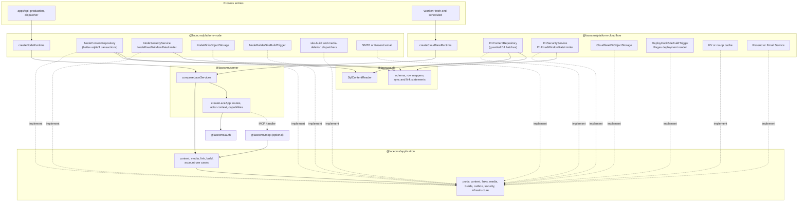

# Runtimes, ports and database portability

Part of the [Lace architecture](README.md).

## 15. Infrastructure ports

Application contracts live in `packages/application/src/ports/`; email
delivery (`EmailSender`) stays beside the account use cases. Each port is
narrow, and use cases depend only on the capabilities they call.

| Port file | Main contracts |
| --- | --- |
| `infrastructure` | `ObjectStorage` (put, get as `AsyncIterable<Uint8Array>`, delete, read URL), `Cache`, `Clock`, `IdGenerator`, `OperationalLogger` |
| `content` | `ContentEntryReadPort`, `ContentEntryCommandPort`, `PublicContentReadPort` (public reads and paged build export) |
| `links` | `ContentLinkReadPort` (link targets, usage and impact) |
| `media` | `MediaReadPort`, `MediaListPort`, `MediaCatalogPort`, `MediaCommandPort`, `MediaDeletionDispatchPort`, `ImageInspector` |
| `builds` | `SiteBuildTrigger`, `SiteBuildCommandPort`, `SiteBuildReadPort`, `SiteBuildDispatchPort`, `ProviderDeploymentReader` |
| `outbox` | `DispatcherLeasePort` (claim, complete, retry leased events) |
| `security` | `AccountSecurityPort`, `SessionSecurityPort`, `TokenSecurityPort`, `UserProfileReader`, `SensitiveRateLimiter` |

`SecurityService` combines the account, session and token ports with
`UserProfileReader`; runtime adapters implement the combined contract.

Both runtimes compose the portable services in one place:
`composeLaceServices` in `packages/server` receives the runtime adapters
(repository, security, object storage, image inspector, clock, ids, list-query
limits, logger, email sender, rate-limit persistence, client-address lookup,
authentication boundaries, optional MCP and OAuth adapters, HTTP settings) and
returns the content, media, link, build, account and OAuth-connection use cases
plus the complete `createLaceApp` input. `createNodeRuntime` and
`createCloudflareRuntime` build adapters, dispatchers and process wiring only.
`LACE_API_DOCS_ENABLED` and `LACE_MCP_ENABLED` are parsed by one shared rule.
Route modules receive actor resolution and the capabilities they call, never
the raw application input, and depend on the narrow security ports.

Implementations:

| Capability | Cloudflare | Node/VPS |
| --- | --- | --- |
| SQL | Drizzle D1 | Drizzle SQLite |
| Object storage | native R2 binding | S3 client configured for MinIO |
| Cache | Workers KV when a `CACHE` binding exists, otherwise no-op | no-op |
| API runtime | Cloudflare Worker | Hono Node server |
| Build trigger | Cloudflare deploy hook | authenticated fixed-command builder |
| Deployment tracking | optional Pages API reader (Pages Read token, Worker secret) | not needed (builder result is proof) |
| Recovery dispatch | scheduled Worker | container timer/worker |
| Email delivery | Resend over `fetch`, or the Email Service `send_email` binding (Workers Paid) | SMTP through nodemailer, or Resend over `fetch` |

Email delivery is selected by `LACE_EMAIL_PROVIDER` (`none` by default, `log`,
`smtp`, `resend`, or `cloudflare`) and requires a `LACE_EMAIL_FROM` sender for
every provider except `none`. Each send resolves to `sent` or `failed` with a
closed reason (`not_configured`, `invalid_message`, `rejected`, `rate_limited`,
`unavailable`). Recipients and subjects are validated against header injection
before any provider is contacted. `log` writes messages to standard output and
is refused in production; production SMTP requires STARTTLS or implicit TLS.
Startup names invalid email variables without repeating their values, and
provider secrets never appear in logs, errors, status, or doctor output. Sends
are synchronous with a bounded timeout; there is no email outbox or retry queue.

R2 and MinIO use different concrete adapters even though both expose
S3-compatible concepts: Cloudflare uses the native R2 binding, Node the S3
client against MinIO.

KV is a derived cache, never an authoritative source, and correctness must not
depend on immediate KV consistency. The no-op cache is the default in both
runtimes; enabling the KV adapter requires cache-key contract tests and is
never on the critical path to the first production deployment.

## 16. Database portability and D1 constraints

The product supports the SQLite dialect only
([ADR 0024](../adr/0024-sqlite-dialect-capability-adapters.md)):

- Cloudflare D1 in production and Cloudflare-compatible development;
- a local SQLite file in Node and Docker.

Drizzle schemas and migrations stay within the SQL subset supported by both
environments. The `db` column-list drift test applies every checked-in
migration to an in-memory database, checks each shared SQL column against its
table and prepares each statement. `pnpm db:check`, included in `pnpm lint`,
checks the migration snapshot chain and detects schema changes that need a
migration in a disposable copy.

D1 free-plan constraints that shape the design:

- 500 MB maximum size for one free-plan database;
- 2 MB maximum string, BLOB, or row size;
- 50 database queries per free-plan Worker invocation;
- daily row-read and row-write quotas.

The architecture responds by:

- placing binary media outside SQL;
- storing one block per row rather than one potentially huge page row;
- loading a snapshot's blocks in one indexed query;
- delivering the bulk build export in bounded pages: each page request
  (including build-token verification) stays within the 50-query limit, using
  at most two D1 batches with at most ten range-bounded read statements and no
  identifier lists that grow with page size, while the 4 MB stored-JSON page
  budget bounds memory and CPU per invocation (the Free-plan 10 ms CPU limit is
  best effort, since one maximal entry can exceed it);
- avoiding N+1 queries;
- copying blocks with set-based SQL;
- retaining only draft and current published snapshots;
- using focused indexes rather than indexing every field.

Collection queries execute model-scoped, prepared JSON predicates before LIMIT
on both SQLite and D1, with fixed statement counts and no application JSON
scan. Literal search/contains use bound ordinary LIKE patterns with ESCAPE, and
text equality uses `= COLLATE NOCASE`. ASCII case is ignored; Cyrillic case is
retained and Е/е/Ё/ё are distinct. Search policy is runtime-specific as in §12;
matching results and boundaries agree across runtimes for queries accepted by
both. No GLOB case-pair compiler, segmented/recursive matcher, ICU, FTS or
persisted search projection exists. String sorting retains SQLite NOCASE
ordering. Configured queries may scan model drafts; the unconfigured indexed
default path remains intact. Collection queries rely only on the nullable
public-projection identity columns described in §9.1 and add no persisted
field index or content backfill. Node and actual local D1 performance evidence
covers 1,000 entries and near-limit fields; backend limits fail visibly.
String-sort continuations add at most one constant indexed anchor lookup,
independent of page size; anchors are never resolved by per-entry reads or
full JSON loads, and query counts distinguish first pages from anchored
continuations.

Media tag filtering adds at most five indexed EXISTS lookups per candidate in
the single list-page query. Tags are read with a bounded correlated projection,
with no per-item round trips. Catalog pages use one indexed aggregate query
over `(tag, media_id)` with a literal prefix range and keyset continuation. Tag
replacement uses the guarded batch and at most 20 inserted rows; all statements
remain within D1 parameter and invocation budgets.

JSON values are stored as SQLite `TEXT` and validated before persistence.
Fields that later require indexed filtering may be promoted to generated
columns or a dedicated index table through a migration.

Additive columns use a plain `ALTER TABLE … ADD` on both runtimes (for example
the nullable `content_snapshots.seo_json` and the block envelope columns, whose
`NOT NULL` columns carry constant defaults); they rewrite no rows and need no
backfill.

A migration that must rebuild a table referenced by foreign keys (for example
`0007`, which widens the `content_models.kind` check) runs
`PRAGMA defer_foreign_keys = on`, creates the replacement table, copies every
row, drops the old table and renames the replacement, all in one migration
file. D1 applies the file as one batch and accepts the deferred drop and
rename; D1 cannot switch foreign keys off. Node SQLite does not clear the
deferred violation counted by the drop, so the explicit Node migrator follows
SQLite's documented rebuild procedure instead: it suspends `foreign_keys` on
its own connection while the migrations run, runs `PRAGMA foreign_key_check`,
and fails unless the check is empty before restoring enforcement. Application
connections always keep foreign keys on.

### Runtime deltas

Node SQLite and D1 share every row mapper, every identical read
(`SqlContentReader`) and the configuration-sync and link statement builders.
The write paths stay runtime-specific (interactive transactions versus guarded
batches, [ADR 0002](../adr/0002-d1-batches-and-node-transactions.md)). Every
remaining intentional difference is listed here; where it could be observable,
a shared repository contract case pins the result.

| Area | Node SQLite | D1 | Observable result pinned by |
| --- | --- | --- | --- |
| Build and dispatcher claims | select and lease update in one transaction | select, then one guarded batch | aligned: at most 10 site-build leases (`MAX_SITE_BUILD_CLAIMS_PER_CALL`, four D1 batch statements each) and 20 dispatcher leases (`MAX_DISPATCHER_CLAIMS_PER_CALL`) per call; site-build lease update guarded by the read `payload_json` on both; contract "caps site-build and dispatcher claims per call" |
| Revision conflicts | `changes !== 1` on the guarded write | pre-check after replay, guarded batch, post-batch disambiguation | aligned precedence: replay → stale revision → link targets; contract cases for concurrent saves and stale publication |
| Publication result | committed entry reloaded inside the transaction | pre-batch prediction, stored in the same batch as the idempotency record | returned entry, its replay and the unpublication result equal a later `load` |
| `mutation_guards` | only an in-transaction dirty token for the shared sync link statements; inserted and deleted before commit | batch guard tokens for every guarded mutation | not observable |
| Build export page | both read groups in one read transaction | two `batch()` calls with a version re-read | contract build-export cases; Node one extra in-transaction version read |
| Collection `list` and configuration-sync scans | numbered parameters, `NODE_LIST_QUERY_LIMITS` | positional parameters, `CLOUDFLARE_LIST_QUERY_LIMITS` | collection-query contract cases (§12 limits differ by design) |
| Bind chunk for identifier lists | 200 | 100 (`D1_MAX_BOUND_PARAMETERS`) | not observable |
| Entry reload inside writes | synchronous loader inside publication transactions | awaited shared reader | covered by the publication result row |
